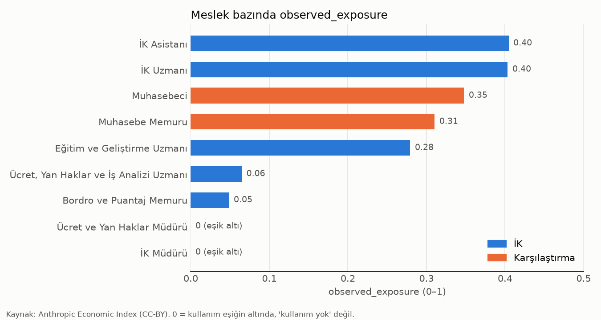
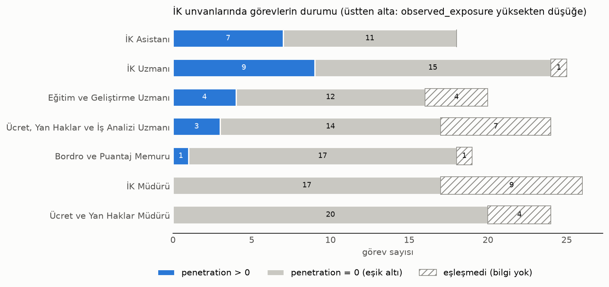
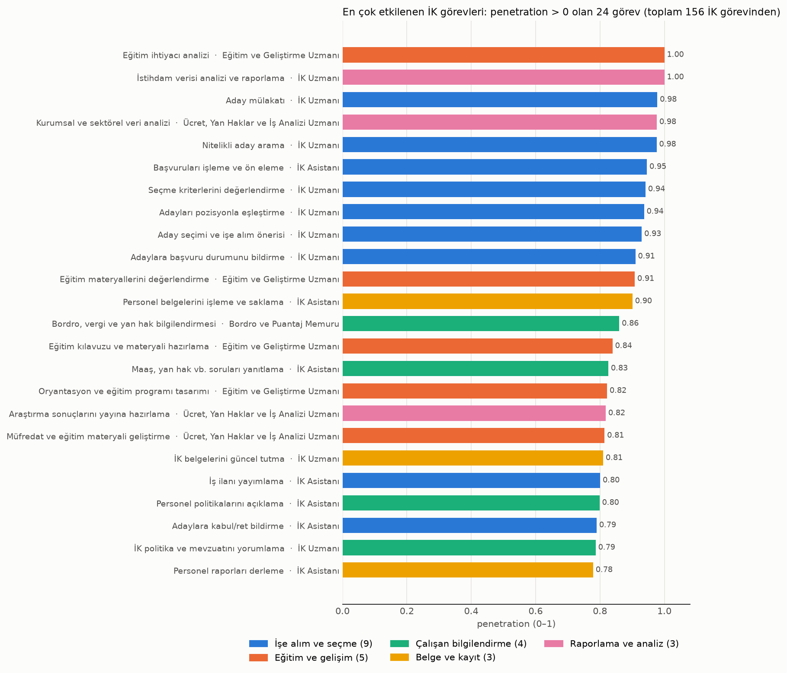
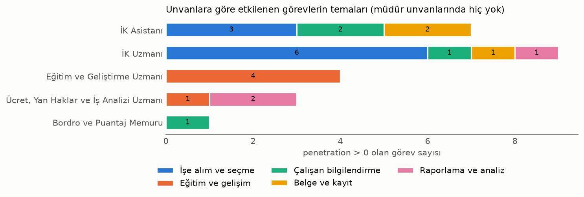

# hr-ai-exposure-analysis

İK mesleklerinin görevlerinin Claude kullanımında ne kadar göründüğünü inceleyen bir keşif projesi.
Veri kaynağı Anthropic Economic Index. Şu anki aşama veriyi tanımak ve betimleyici bulgular çıkarmak.

Ayrıntılar ve kod: [notebooks/00_veriyi_tani.ipynb](notebooks/00_veriyi_tani.ipynb)

---

## Veri seti

**Anthropic Economic Index** ([Hugging Face](https://huggingface.co/datasets/Anthropic/EconomicIndex), CC-BY).
Anthropic, Claude'daki iş amaçlı konuşmaları ABD meslek veritabanı **O*NET**'teki görevlerle eşleştirip
her göreve ve mesleğe bir puan vermiş. Birbirine bağlı üç tablo kullanıyoruz:

```
job_exposure (meslek)  ──kod──▶  onet_task_statements (meslek → görevler)  ──görev metni──▶  task_penetration (görev → puan)
```

| Tablo | Satır | Her satır | Sütunlar |
|---|---|---|---|
| `onet_task_statements.csv` | 19.530 | bir meslekteki bir görev | `O*NET-SOC Code` (meslek kodu, ör. `13-1071.00`), `Title` (meslek adı), `Task ID`, `Task` (görev metni), `Task Type` (**Core** = asıl görev, **Supplemental** = ek görev), `Incumbents Responding` (görevi değerlendiren çalışan sayısı), `Date` (güncellenme tarihi, 2003–2015), `Domain Source` (bilgiyi veren: Incumbent / Occupational Expert / Analyst) |
| `task_penetration.csv` | 17.998 | bir görev | `task` (görev metni; Task ID yok), `penetration` (0–1) |
| `job_exposure.csv` | 756 | bir meslek | `occ_code` (ör. `13-1071`, `.00` yok), `title`, `observed_exposure` (0–1) |

**`penetration`**: Görevin Claude'un iş kullanımında "kapsanma" puanı. **0**, görevin eşiği geçecek kadar
sık görülmediği anlamına gelir; "hiç kullanılmıyor" demek değildir. Görev yeterince görülmüşse puan
**0,5–1** arasındadır: Claude işi kendisi yapıyorsa (otomasyon) tam puan, yardımcı oluyorsa (destek)
yarım puan. 0 ile 0,5 arasında değer yok, bu yüzden puanı daha çok "görüldü / görülmedi" bayrağı gibi okuyun.

**`observed_exposure`**: Meslek düzeyinde puan. Görev puanlarının, her göreve harcanan zamana göre
ağırlıklı ortalaması. Bir "işini kaybetme riski" skoru **değildir**.

Tanımların kaynağı: [Anthropic, *Labor market impacts of AI*](https://www.anthropic.com/research/labor-market-impacts)
(veri klasöründe README yok). İndirme adımları: [data/README.md](data/README.md)

---

## Öne çıkan bulgular

> Bulgular betimleyicidir ve yalnızca Claude kullanımını kapsar. 0 = eşik altı, "kullanım yok" değil.
> Meslek ve görev düzeyindedir; bireyler hakkında yargıya dönüştürülmez.

**1. İK unvanları ikiye ayrılıyor.** İK Asistanı (0,40) ve İK Uzmanı (0,40), muhasebe mesleklerinin
(0,35 ve 0,31) üstünde. Bordro Memuru (0,05) ve Ücret Uzmanı (0,06) düşük. İK Müdürü ve Ücret ve Yan
Haklar Müdürü 0'da (eşik altı).



**2. Etkilenen görevler az ama belirgin.** 156 İK görevinin **24'ü (%15)** 0'dan büyük, 106'sı 0, 26'sı
eşleşmedi. Görülen görevlerin değeri hep yüksek (0,78–1,00).



**3. En çok etkilenen iş alanı: işe alım ve seçme.** 24 pozitif görevin 9'u işe alımla ilgili: aday arama,
ön eleme, mülakat, eşleştirme, işe alım önerisi, kabul/ret bildirme. Sonra eğitim ve gelişim (5),
çalışan bilgilendirme (4), belge ve kayıt (3), raporlama ve analiz (3) geliyor.



**4. Unvan bazında.** Pozitif görevlerin dağılımı:
- **İK Uzmanı:** 9 görev, ağırlıklı olarak işe alım.
- **İK Asistanı:** 7 görev.
- **Eğitim ve Geliştirme Uzmanı:** 4 görev, hepsi eğitim ve hepsi Core.
- **Ücret, Yan Haklar ve İş Analizi Uzmanı:** 3 görev, hepsi Supplemental. Eşleşen Core görevlerinin hiçbiri görülmüyor.
- **Bordro Memuru:** 1 görev (bilgilendirme). Bordro işleme görevlerinin hepsi 0.



**5. Aynı iş, farklı unvan.** İşe alım, raporlama ve eğitim ihtiyacı analizi gibi işler uzman ve asistan
unvanlarında yüksek değer alıyor. Müdür unvanlarındaki benzer görevler ise 0 ya da eşleşmemiş. Bunun bir
nedeni, makaledeki bir yöntem kuralı olabilir: benzer görevlerde kullanım sayıları aralarında bölünüyor.
"Müdürler etkilenmiyor" sonucuna varmak için erken.

Türkçe çevirili görev listesi: `reports/tables/en_cok_etkilenen_gorevler.xlsx`. Çeviriler ve temalar
Claude tarafından elle atandı, kontrol edilmeli.

---

## Kurulum (Windows / PowerShell)

```powershell
python -m venv .venv
.\.venv\Scripts\Activate.ps1
pip install -r requirements.txt
jupyter notebook notebooks/00_veriyi_tani.ipynb
```

## Yapı

```
data/              veri (git'e girmez, bkz. data/README.md)
notebooks/         00_veriyi_tani.ipynb
reports/figures/   5 grafik (PNG)
reports/tables/    ik_gorevleri.xlsx (tüm İK görevleri + "Benim yorumum")
                   en_cok_etkilenen_gorevler.xlsx (24 görev, Türkçe)
```

Kurallar: [CLAUDE.md](CLAUDE.md)

## Lisans

Kod: MIT (bkz. `LICENSE`). Veri: Anthropic Economic Index, CC-BY; bu repoda bulunmaz, kaynağı `data/README.md` içinde.
